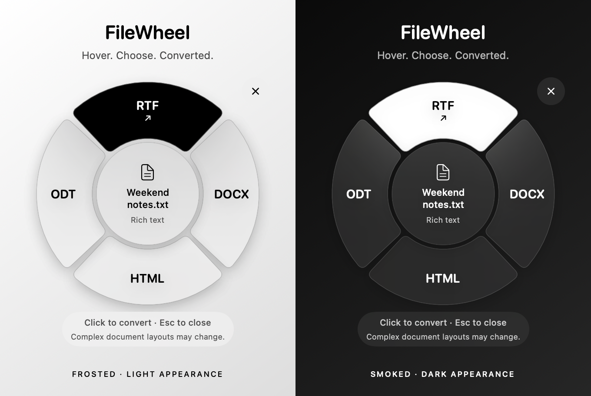

<div align="center">


# FileWheel

### A new format. A small gesture.

A translucent conversion wheel for Finder and your desktop.

[](https://github.com/ethan-rong/filewheel/actions/workflows/check.yml)


[](LICENSE)

**Hover. Choose. Keep the original.**

</div>



<p align="center"><sub>Rendered from the actual SwiftUI view. Backdrop appearance depends on your desktop and macOS accessibility settings.</sub></p>

## Right where your files are

**Early preview:** conversion tests pass locally. Live Finder-hover verification is pending on the development Mac; the integration depends on Finder's accessibility tree and the user's permission.

Move your pointer onto a supported file. A compact, 256-point wheel appears with formats that fit that file, without an intentional hover delay (the pointer is checked every 50 ms; Finder response time varies). Click a format to start conversion immediately; the converted copy lands beside the original. Large files still take time to process. If the name is taken, FileWheel adds a number.

No main app window, account, or upload. One local setup builds a small menu-bar helper from source and starts it at login. **Local code is required**: a website cannot inspect the file under your pointer in Finder. macOS packages the helper in an `.app` bundle for its permission identity; you do not download a separate application or keep a window open.

## Set up once

Requires **macOS 13 or later**, Apple Command Line Tools with **Swift 5.9+**, and Git. If needed, install Apple's tools with `xcode-select --install`, then finish that installation before continuing.

```sh
git clone https://github.com/ethan-rong/filewheel.git
cd filewheel
./scripts/install.sh
```

Enable **FileWheel** in **System Settings → Privacy & Security → Accessibility**. Use **Enable Finder hover…** from its menu-bar icon to open that pane. The wheel preview and **Choose a file…** work without Accessibility access.

Optional local conversion engines:

```sh
brew install ffmpeg   # Audio and video
brew install webp     # WebP output
```

These are installed separately through [Homebrew](https://brew.sh/); FileWheel does not silently download engines. Native image, PDF, and document conversion needs neither.

## The wheel

| Action | Result |
| --- | --- |
| Move the pointer onto a Finder or desktop file | Open its format wheel without a dwell delay |
| Hover a sector | Preview a format |
| Click a sector or press Return | Convert |
| Scroll, Tab / Shift-Tab, or arrow keys | Move between formats |
| Escape or click elsewhere | Close the wheel |
| Cancel while converting | Stop; leave the original intact |
| Show in Finder after conversion | Reveal the output |
| Menu bar → Pause hovering | Stop automatic wheels until resumed |

White frosted material in light mode. Black smoked material in dark mode. Opaque labels and an inverted black/white selection keep both readable. The wheel respects **Reduce Transparency** and **Reduce Motion**. Its full panel is 280 × 316 points, including the small usage hint; there is no header bar.

## Common formats, real conversions

| Input | Outputs | Engine |
| --- | --- | --- |
| Still images supported by macOS, including PNG, JPG, HEIC, TIFF, BMP, WebP | PNG, JPG, HEIC, TIFF, BMP, PDF; WebP with its optional encoder | Image I/O, Core Graphics; optional `cwebp` |
| TXT, Markdown, RTF, DOC, DOCX, ODT, HTML | TXT, RTF, DOCX, HTML, ODT | macOS `textutil` |
| PDF | PNG, JPG, TIFF in a folder containing **every page**; TXT when text is extractable | PDFKit |
| MP3, M4A, WAV, FLAC, OGG, AIFF, AAC, Opus | MP3, M4A, WAV, FLAC, AIFF, OGG/Opus | Optional FFmpeg |
| MP4, MOV, MKV, WebM, AVI, M4V, MPEG | MP4, MOV, MKV, WebM; MP3 or WAV audio extraction | Optional FFmpeg |

The wheel omits the current extension. Image outputs depend on the encoders available on that Mac. A source's extension identifies the candidate conversion family; the engine still validates its contents. Renaming an extension is never presented as conversion.

### Know what changes

- Originals and existing outputs are never overwritten. Intermediate files are staged in a private temporary folder beside the source and cleaned up after success, failure, or cancellation.
- Image conversion preserves visual orientation, but does not retain photo metadata. Transparent areas become white in formats without alpha. Animated/multi-frame images and SVG are not supported. Images above 100 megapixels are rejected.
- PDF images render every page at 144 dpi into a new folder. Text extraction does not include OCR or PDF-to-Word. Locked PDFs need to be unlocked first.
- Document layouts may change. Markdown is handled as literal plain text, not rendered Markdown. HTML resource loading is disabled.
- Audio conversion takes the first audio track. Video conversion takes the main video and first audio track and omits subtitles/extra tracks. Lossy formats may reduce quality; these are not archival conversions.
- Unsupported files, directories, and symbolic links are ignored or rejected. Download cloud placeholders before converting. The source folder must be writable.

## Finder permissions & privacy

Accessibility lets the helper read the Finder item under your pointer. It checks that the hit belongs to Finder before resolving a file. Where Finder does not expose a file URL, it uses the displayed name and enclosing folder; ambiguous names are rejected rather than guessed.

Conversions run locally. There is no telemetry, account system, or upload endpoint. FFmpeg is restricted to local file/pipe protocols. The help menu opens this GitHub repository in your browser. This helper is locally built and ad-hoc signed, not notarized.

Finder's accessibility tree varies between views and macOS versions. If a view does not expose enough information, use **Choose a file…** from the menu bar. After rebuilding, macOS may require removing and re-adding the helper's Accessibility entry.

## Build, test, remove

```sh
swift test
swift build -c release
.build/release/FileWheel --render-preview docs/preview.png
```

The tests perform real image/document/audio/video conversions, decode the results, check orientation and all-page PDF export, verify collision handling and source preservation, reject ambiguous Finder names and symlinks, and cancel a running subprocess. Audio/video tests skip when FFmpeg is absent; CI installs it.

Installed files:

```text
~/Library/Application Support/FileWheel/FileWheel.app
~/Library/LaunchAgents/io.github.ethan-rong.filewheel.plist
```

To update, pull the source and rerun `./scripts/install.sh`. To remove it, finish or cancel any conversion, then run:

```sh
./scripts/uninstall.sh
```

Converted files stay where you saved them. Remove the Accessibility entry separately in System Settings if desired.

## Design & credits

Built with **SwiftUI, AppKit, SF Symbols, Image I/O, and PDFKit**. No third-party Swift packages. [Design notes →](docs/DESIGN.md)

The radial interaction is inspired by [Filee](https://filee.sh/). FileWheel's code and visual identity are original; this project is not affiliated with Filee. External conversion engines retain their own licenses and are not bundled.

[MIT license](LICENSE) · Early macOS release
